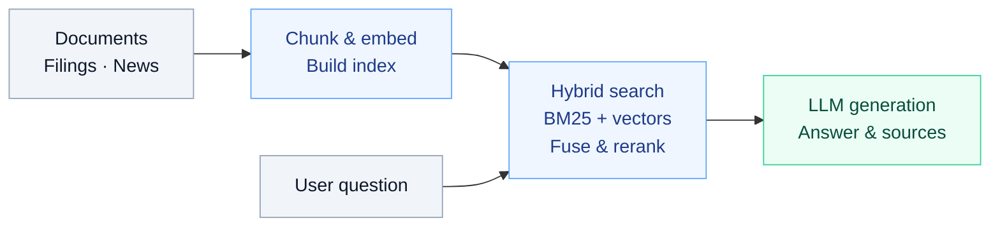

<h1 align="center">DeepSearch Agent</h1>

<p align="center"><strong>Turn your sources into answers you can trace.</strong></p>
<p align="center">Document Q&A &nbsp;·&nbsp; Company research &nbsp;·&nbsp; PDF briefs</p>

<p align="center">
  <a href="./README.md">简体中文</a> &nbsp;|&nbsp; <strong>English</strong>
</p>

<p align="center">
  <a href="#use-cases">Use cases</a> &nbsp;·&nbsp;
  <a href="#workflow">How it works</a> &nbsp;·&nbsp;
  <a href="#quick-start">Quick start</a> &nbsp;·&nbsp;
  <a href="#finance">Financial research</a>
</p>

---

<a id="use-cases"></a>
## Use cases

**Document Q&A** — Upload Markdown, ask about concepts, procedures, and technical details, and inspect the sources behind each answer.

> Under what conditions does this system invalidate its cache?

**Company research** — Ingest company filings and news summaries to explore risks, business performance, or company comparisons.

> Compare the main risks disclosed by AAPL and MSFT in the ingested filings.

**Research briefs** — Use the ReAct API to retrieve evidence, organize sections, and generate a PDF.

> Summarize AAPL's main risks and create a PDF brief with source references.

The default corpus in `data/docs/` contains technical learning material. Ingest financial sources before company research; answers depend on what is in the knowledge base.

<a id="workflow"></a>
## How it works



Choose one of three ways to use this retrieval pipeline:

| Mode | Workflow | Endpoint |
| --- | --- | --- |
| **Web Q&A** | Direct retrieval → streamed answer | `/chat/stream` |
| **Full agent** | Rewrite or decompose → retrieve → heuristic checks and retries → summarize | `/chat` |
| **ReAct tools** | LLM selects search or PDF tools → execute → return results | `/chat`, `mode=react` |

The web UI supports source references, chat history, and Markdown uploads. ReAct requires a model with tool-calling support. PDFs are saved on the server in `data/exports/`; the API returns their file paths.

<a id="quick-start"></a>
## Quick start

Requires **Python 3.10+** and a working model API. Run the following commands from the repository root on macOS / Linux.

### 1. Install dependencies

```bash
python3 -m venv .venv
source .venv/bin/activate
python -m pip install -r requirements.txt
```

### 2. Configure the model

Create `.env`. Change the base URL and model name to use another compatible service.

```dotenv
LLM_PROVIDER=openai
LLM_API_KEY=your-api-key
LLM_MODEL_NAME=gpt-4o-mini
# LLM_BASE_URL=https://api.openai.com/v1
CHUNKER_CLASSIFIER=rule
```

### 3. Start the app

```bash
# Terminal 1: backend
python main.py
```

In a second terminal, activate the virtual environment in the same directory and start the frontend:

```bash
source .venv/bin/activate
python -m http.server 8080 --directory frontend
```

**[Open the web UI →](http://localhost:8080)** &nbsp; **[Explore the API →](http://localhost:8000/docs)**

<details>
<summary>Runtime notes: models, memory, and storage</summary>

- Startup checks the corpus and updates its index. The first use downloads embedding / reranker models.
- Without a working model configuration, only local fallback responses are available; normal model answers and ReAct tool calls require the model API.
- SQLite stores chat history. Short-term agent memory requires Redis, available at `redis://localhost:6379/0` by default and configurable via `REDIS_URL`.

</details>

<a id="finance"></a>
## Financial research

Ingest **SEC EDGAR** `10-K`, `10-Q`, and `8-K` filings, plus **Alpha Vantage** news summaries and sentiment metadata.

<details>
<summary><strong>Configure and ingest sources</strong></summary>

Add to `.env`:

```dotenv
FINANCE_DOCS_DIR=data/docs_finance
DOCS_DIR=data/docs_finance
INDEX_DIR=data/index_finance
EDGAR_USER_AGENT=Your Name your-email@example.com
ALPHAVANTAGE_API_KEY=your-alphavantage-api-key
```

Keep `DOCS_DIR` and `FINANCE_DOCS_DIR` aligned, and use the same `INDEX_DIR` for ingestion and serving.

```bash
python scripts/ingest_finance.py
python main.py
```

Rerun ingestion to refresh sources. To rebuild an index from existing documents, run `python scripts/ingest_docs.py`. Restart the service after changing its configuration.

</details>

<details>
<summary><strong>Example: generate a company risk PDF brief</strong></summary>

After ingesting financial sources, call the ReAct API:

```bash
curl http://localhost:8000/chat \
  -H 'Content-Type: application/json' \
  -d '{
    "query": "Summarize AAPL risk factors from the knowledge base and create a PDF brief with source references.",
    "session_id": "research-aapl",
    "mode": "react"
  }'
```

The response's `artifacts` field contains the server-side path of the generated file.

</details>
