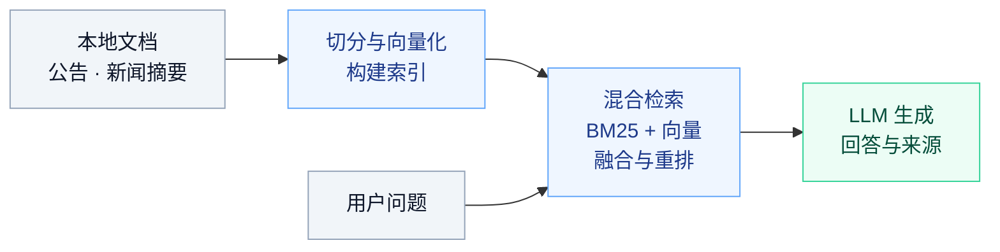
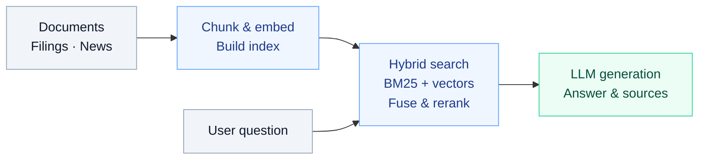

<a id="zh-cn"></a>

<h1 align="center">DeepSearch Agent</h1>

<p align="center"><strong>从资料出发，给出有据可查的回答。</strong></p>
<p align="center">文档问答 &nbsp;·&nbsp; 公司研究 &nbsp;·&nbsp; PDF 简报</p>

<p align="center">
  <strong>简体中文</strong> &nbsp;|&nbsp; <a href="#en">English</a>
</p>

<p align="center">
  <a href="#zh-use-cases">使用场景</a> &nbsp;·&nbsp;
  <a href="#zh-workflow">工作流程</a> &nbsp;·&nbsp;
  <a href="#zh-quick-start">快速开始</a> &nbsp;·&nbsp;
  <a href="#zh-finance">金融研究</a>
</p>

---

<a id="zh-use-cases"></a>
## 使用场景

**文档问答** — 上传 Markdown，从已有资料中查询概念、流程与技术细节，查看回答对应的来源。

> 这套系统在什么条件下触发缓存失效？

**公司研究** — 采集公司公告与新闻摘要，整理风险、经营情况，或比较不同公司。

> 根据已入库的公告，比较 AAPL 和 MSFT 披露的主要风险。

**研究简报** — 通过 ReAct API，让 Agent 检索资料、组织章节并生成 PDF。

> 总结 AAPL 的主要风险，生成一份带来源引用的 PDF 简报。

默认知识库为 `data/docs/` 中的技术教材。公告解读需要先采集金融资料；结构化财务取数直接访问 SEC，无需提前入库。

<a id="zh-workflow"></a>
## 工作流程



在这条检索链路上，可以选择三种使用方式：

| 使用方式 | 工作流程 | 入口 |
| --- | --- | --- |
| **网页问答** | 直接检索 → 流式回答 | `/chat/stream` |
| **完整 Agent** | 重写或拆分问题 → 检索 → 启发式验证与重试 → 汇总 | `/chat` |
| **ReAct 工具调用** | LLM 选择检索、财务取数、计算或 PDF 工具 → 执行 → 返回结果 | `/chat`，`mode=react` |

网页支持引用、聊天记录和 Markdown 上传，目前走检索链路。财务工具使用 ReAct API，需要支持工具调用的模型；生成的 PDF 保存在服务端 `data/exports/`，API 返回文件路径。

<a id="zh-quick-start"></a>
## 快速开始

需要 **Python 3.10+** 和可用的模型 API。以下命令在项目根目录执行，适用于 macOS / Linux。

### 1. 安装依赖

```bash
python3 -m venv .venv
source .venv/bin/activate
python -m pip install -r requirements.txt
```

### 2. 配置模型

创建 `.env`。使用其他兼容服务时，修改地址和模型名。

```dotenv
LLM_PROVIDER=openai
LLM_API_KEY=your-api-key
LLM_MODEL_NAME=gpt-4o-mini
# LLM_BASE_URL=https://api.openai.com/v1
CHUNKER_CLASSIFIER=rule
```

### 3. 启动服务

```bash
# 终端 1：启动后端
python main.py
```

另开终端，在同一目录激活虚拟环境后启动前端：

```bash
source .venv/bin/activate
python -m http.server 8080 --directory frontend
```

**[打开网页 →](http://localhost:8080)** &nbsp; **[浏览 API →](http://localhost:8000/docs)**

<details>
<summary>运行说明：模型、记忆与存储</summary>

- 服务启动时自动检查语料并更新索引；首次使用需要下载 embedding / reranker 模型。
- 没有配置可用模型时，只能使用本地兜底响应，无法提供正常的模型回答或 ReAct 工具调用。
- SQLite 保存聊天记录；Agent 短期对话记忆需要 Redis，默认地址为 `redis://localhost:6379/0`，可通过 `REDIS_URL` 修改。

</details>

<a id="zh-finance"></a>
## 金融研究

支持采集 **SEC EDGAR** 的 `10-K`、`10-Q`、`8-K`，以及 **Alpha Vantage** 的新闻摘要与情绪元数据。

### 财务取数与计算

**问题 → SEC 财务数据 → 指标计算 → 带公告来源的回答**。需要解释业务原因时，再结合知识库检索。

| 工具 | 用途 |
| --- | --- |
| `get_financials` | 获取营收、净利润、资产、股东权益、现金和经营现金流；返回财年、币种、公告链接和数据快照 ID |
| `calculate_metrics` | 读取该快照，计算营收同比、净利润同比、净利率和经营现金流／营收比率，返回公式与原始输入 |
| `search_knowledge_base` | 查找已入库公告和新闻中的风险、业务变化与解释 |
| `generate_pdf` | 把研究结果与引用整理成 PDF |

当前财务工具支持 **SEC 年度 US-GAAP 美元数据**，不包含季度、TTM、股价或预测。`as_of` 是披露截止日，默认今天；按截止日前的最新披露取值，可能包含后续修订。同比校验连续财年和指标定义，利润率要求同一公告版本；数据缺失、冲突或分母非正会返回原因，不会补零。

<details>
<summary><strong>示例：计算 AAPL 的增长率和净利率</strong></summary>

在 `.env` 配置 `EDGAR_USER_AGENT=Your Name your-email@example.com`，重启服务后调用：

```bash
curl http://localhost:8000/chat \
  -H 'Content-Type: application/json' \
  -d '{
    "query": "获取 AAPL 最近三个财年的营收和净利润，计算营收同比、净利润同比和净利率，标明实际财年及公告来源。",
    "session_id": "financials-aapl",
    "mode": "react"
  }'
```

Agent 先调用 `get_financials`，再将返回的 `dataset_id` 传给 `calculate_metrics`，无需模型重填数字。三个财年可计算两组同比。SEC 响应缓存一小时，计算快照保存在本地 `data/financial_cache/`，不提交到 Git。

</details>


<details>
<summary><strong>配置数据源并采集</strong></summary>

在 `.env` 中增加：

```dotenv
FINANCE_DOCS_DIR=data/docs_finance
DOCS_DIR=data/docs_finance
INDEX_DIR=data/index_finance
EDGAR_USER_AGENT=Your Name your-email@example.com
ALPHAVANTAGE_API_KEY=your-alphavantage-api-key
```

保持 `DOCS_DIR` 与 `FINANCE_DOCS_DIR` 一致，采集和服务使用同一个 `INDEX_DIR`。

```bash
python scripts/ingest_finance.py
python main.py
```

重新运行采集脚本可更新资料。已有文档仅需重建索引时，运行 `python scripts/ingest_docs.py`。修改配置后重启服务。

</details>

<details>
<summary><strong>示例：生成公司风险 PDF 简报</strong></summary>

完成金融资料采集后，调用 ReAct API：

```bash
curl http://localhost:8000/chat \
  -H 'Content-Type: application/json' \
  -d '{
    "query": "根据知识库总结 AAPL 的主要风险，并生成带来源引用的 PDF 简报。",
    "session_id": "research-aapl",
    "mode": "react"
  }'
```

响应中的 `artifacts` 包含生成文件的服务端路径。

</details>

---

<a id="en"></a>

<h1 align="center">DeepSearch Agent</h1>

<p align="center"><strong>Turn your sources into answers you can trace.</strong></p>
<p align="center">Document Q&A &nbsp;·&nbsp; Company research &nbsp;·&nbsp; PDF briefs</p>

<p align="center">
  <a href="#zh-cn">简体中文</a> &nbsp;|&nbsp; <strong>English</strong>
</p>

<p align="center">
  <a href="#en-use-cases">Use cases</a> &nbsp;·&nbsp;
  <a href="#en-workflow">How it works</a> &nbsp;·&nbsp;
  <a href="#en-quick-start">Quick start</a> &nbsp;·&nbsp;
  <a href="#en-finance">Financial research</a>
</p>

---

<a id="en-use-cases"></a>
## Use cases

**Document Q&A** — Upload Markdown, ask about concepts, procedures, and technical details, and inspect the sources behind each answer.

> Under what conditions does this system invalidate its cache?

**Company research** — Ingest company filings and news summaries to explore risks, business performance, or company comparisons.

> Compare the main risks disclosed by AAPL and MSFT in the ingested filings.

**Research briefs** — Use the ReAct API to retrieve evidence, organize sections, and generate a PDF.

> Summarize AAPL's main risks and create a PDF brief with source references.

The default corpus in `data/docs/` contains technical learning material. Ingest financial sources for narrative research; structured financial tools query SEC directly without prior ingestion.

<a id="en-workflow"></a>
## How it works



Choose one of three ways to use this retrieval pipeline:

| Mode | Workflow | Endpoint |
| --- | --- | --- |
| **Web Q&A** | Direct retrieval → streamed answer | `/chat/stream` |
| **Full agent** | Rewrite or decompose → retrieve → heuristic checks and retries → summarize | `/chat` |
| **ReAct tools** | LLM selects search, financial data, calculation or PDF tools → execute → return results | `/chat`, `mode=react` |

The web UI supports source references, chat history, and Markdown uploads through the retrieval pipeline. Financial tools use the ReAct API and require a model with tool-calling support. PDFs are saved on the server in `data/exports/`; the API returns their file paths.

<a id="en-quick-start"></a>
## Quick start

Requires **Python 3.10+** and a working model API. Run the following commands from the repository root on macOS / Linux.

### 1. Install dependencies

```bash
python3 -m venv .venv
source .venv/bin/activate
python -m pip install -r requirements.txt
```

### 2. Configure the model

Create `.env`. Change the base URL and model name to use another compatible service.

```dotenv
LLM_PROVIDER=openai
LLM_API_KEY=your-api-key
LLM_MODEL_NAME=gpt-4o-mini
# LLM_BASE_URL=https://api.openai.com/v1
CHUNKER_CLASSIFIER=rule
```

### 3. Start the app

```bash
# Terminal 1: backend
python main.py
```

In a second terminal, activate the virtual environment in the same directory and start the frontend:

```bash
source .venv/bin/activate
python -m http.server 8080 --directory frontend
```

**[Open the web UI →](http://localhost:8080)** &nbsp; **[Explore the API →](http://localhost:8000/docs)**

<details>
<summary>Runtime notes: models, memory, and storage</summary>

- Startup checks the corpus and updates its index. The first use downloads embedding / reranker models.
- Without a working model configuration, only local fallback responses are available; normal model answers and ReAct tool calls require the model API.
- SQLite stores chat history. Short-term agent memory requires Redis, available at `redis://localhost:6379/0` by default and configurable via `REDIS_URL`.

</details>

<a id="en-finance"></a>
## Financial research

Ingest **SEC EDGAR** `10-K`, `10-Q`, and `8-K` filings, plus **Alpha Vantage** news summaries and sentiment metadata.

### Financial data and calculations

**Question → SEC financial facts → Metric calculation → Answer with filing sources**. Combine with knowledge-base search to explain business changes.

| Tool | Purpose |
| --- | --- |
| `get_financials` | Fetch revenue, net income, assets, stockholders’ equity, cash and operating cash flow, with fiscal periods, currency, filing links and a dataset ID |
| `calculate_metrics` | Read that snapshot to calculate revenue growth, net income growth, net margin and operating cash flow margin, with formulas and input evidence |
| `search_knowledge_base` | Find risks, business changes and explanations in ingested filings and news |
| `generate_pdf` | Export research findings and references as a PDF |

Financial tools currently support **SEC annual US-GAAP facts in USD**; quarterly data, TTM, prices and forecasts are excluded. `as_of` is the filing cutoff, defaulting to today. Values use the latest eligible disclosures and may include later revisions. Growth requires consecutive fiscal periods and matching concepts; margins require the same filing version. Missing or conflicting data and nonpositive denominators return a reason, never an assumed zero.

<details>
<summary><strong>Example: calculate AAPL growth and net margin</strong></summary>

Set `EDGAR_USER_AGENT=Your Name your-email@example.com` in `.env`, restart the server, then call:

```bash
curl http://localhost:8000/chat \
  -H 'Content-Type: application/json' \
  -d '{
    "query": "Fetch AAPL revenue and net income for the latest three fiscal years. Calculate revenue growth, net income growth and net margin, with actual fiscal dates and filing sources.",
    "session_id": "financials-aapl",
    "mode": "react"
  }'
```

The agent calls `get_financials`, then passes its `dataset_id` to `calculate_metrics` without retyping amounts. Three fiscal years provide two year-over-year comparisons. SEC responses are cached for one hour; calculation snapshots stay in local `data/financial_cache/`, excluded from Git.

</details>


<details>
<summary><strong>Configure and ingest sources</strong></summary>

Add to `.env`:

```dotenv
FINANCE_DOCS_DIR=data/docs_finance
DOCS_DIR=data/docs_finance
INDEX_DIR=data/index_finance
EDGAR_USER_AGENT=Your Name your-email@example.com
ALPHAVANTAGE_API_KEY=your-alphavantage-api-key
```

Keep `DOCS_DIR` and `FINANCE_DOCS_DIR` aligned, and use the same `INDEX_DIR` for ingestion and serving.

```bash
python scripts/ingest_finance.py
python main.py
```

Rerun ingestion to refresh sources. To rebuild an index from existing documents, run `python scripts/ingest_docs.py`. Restart the service after changing its configuration.

</details>

<details>
<summary><strong>Example: generate a company risk PDF brief</strong></summary>

After ingesting financial sources, call the ReAct API:

```bash
curl http://localhost:8000/chat \
  -H 'Content-Type: application/json' \
  -d '{
    "query": "Summarize AAPL risk factors from the knowledge base and create a PDF brief with source references.",
    "session_id": "research-aapl",
    "mode": "react"
  }'
```

The response's `artifacts` field contains the server-side path of the generated file.

</details>
