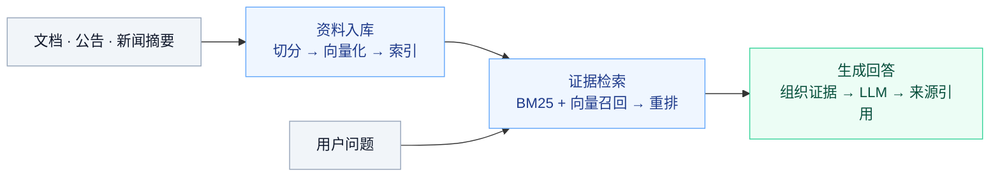

<h1 align="center">DeepSearch Agent</h1>

<p align="center"><strong>从资料出发，给出有据可查的回答。</strong></p>
<p align="center">文档问答 &nbsp;·&nbsp; 公司研究 &nbsp;·&nbsp; PDF 简报</p>

<p align="center">
  <strong>简体中文</strong> &nbsp;|&nbsp; <a href="./README.en.md">English</a>
</p>

<p align="center">
  <a href="#use-cases">使用场景</a> &nbsp;·&nbsp;
  <a href="#workflow">工作流程</a> &nbsp;·&nbsp;
  <a href="#quick-start">快速开始</a> &nbsp;·&nbsp;
  <a href="#finance">金融研究</a>
</p>

---

<a id="use-cases"></a>
## 使用场景

**文档问答** — 上传 Markdown，从已有资料中查询概念、流程与技术细节，查看回答对应的来源。

> 这套系统在什么条件下触发缓存失效？

**公司研究** — 采集公司公告与新闻摘要，整理风险、经营情况，或比较不同公司。

> 根据已入库的公告，比较 AAPL 和 MSFT 披露的主要风险。

**研究简报** — 通过 ReAct API，让 Agent 检索资料、组织章节并生成 PDF。

> 总结 AAPL 的主要风险，生成一份带来源引用的 PDF 简报。

默认知识库为 `data/docs/` 中的技术教材。公司研究需要先采集金融资料，回答范围取决于已入库内容。

<a id="workflow"></a>
## 工作流程



在这条检索链路上，可以选择三种使用方式：

| 使用方式 | 工作流程 | 入口 |
| --- | --- | --- |
| **网页问答** | 直接检索 → 流式回答 | `/chat/stream` |
| **完整 Agent** | 重写或拆分问题 → 检索 → 启发式验证与重试 → 汇总 | `/chat` |
| **ReAct 工具调用** | LLM 选择检索或 PDF 工具 → 执行 → 返回结果 | `/chat`，`mode=react` |

网页支持引用、聊天记录和 Markdown 上传。ReAct 需要支持工具调用的模型；生成的 PDF 保存在服务端 `data/exports/`，API 返回文件路径。

<a id="quick-start"></a>
## 快速开始

需要 **Python 3.10+** 和可用的模型 API。以下命令在项目根目录执行，适用于 macOS / Linux。

### 1. 安装依赖

```bash
python3 -m venv .venv
source .venv/bin/activate
python -m pip install -r requirements.txt
```

### 2. 配置模型

创建 `.env`。使用其他兼容服务时，修改地址和模型名。

```dotenv
LLM_PROVIDER=openai
LLM_API_KEY=your-api-key
LLM_MODEL_NAME=gpt-4o-mini
# LLM_BASE_URL=https://api.openai.com/v1
CHUNKER_CLASSIFIER=rule
```

### 3. 启动服务

```bash
# 终端 1：启动后端
python main.py
```

另开终端，在同一目录激活虚拟环境后启动前端：

```bash
source .venv/bin/activate
python -m http.server 8080 --directory frontend
```

**[打开网页 →](http://localhost:8080)** &nbsp; **[浏览 API →](http://localhost:8000/docs)**

<details>
<summary>运行说明：模型、记忆与存储</summary>

- 服务启动时自动检查语料并更新索引；首次使用需要下载 embedding / reranker 模型。
- 没有配置可用模型时，只能使用本地兜底响应，无法提供正常的模型回答或 ReAct 工具调用。
- SQLite 保存聊天记录；Agent 短期对话记忆需要 Redis，默认地址为 `redis://localhost:6379/0`，可通过 `REDIS_URL` 修改。

</details>

<a id="finance"></a>
## 金融研究

支持采集 **SEC EDGAR** 的 `10-K`、`10-Q`、`8-K`，以及 **Alpha Vantage** 的新闻摘要与情绪元数据。

<details>
<summary><strong>配置数据源并采集</strong></summary>

在 `.env` 中增加：

```dotenv
FINANCE_DOCS_DIR=data/docs_finance
DOCS_DIR=data/docs_finance
INDEX_DIR=data/index_finance
EDGAR_USER_AGENT=Your Name your-email@example.com
ALPHAVANTAGE_API_KEY=your-alphavantage-api-key
```

保持 `DOCS_DIR` 与 `FINANCE_DOCS_DIR` 一致，采集和服务使用同一个 `INDEX_DIR`。

```bash
python scripts/ingest_finance.py
python main.py
```

重新运行采集脚本可更新资料。已有文档仅需重建索引时，运行 `python scripts/ingest_docs.py`。修改配置后重启服务。

</details>

<details>
<summary><strong>示例：生成公司风险 PDF 简报</strong></summary>

完成金融资料采集后，调用 ReAct API：

```bash
curl http://localhost:8000/chat \
  -H 'Content-Type: application/json' \
  -d '{
    "query": "根据知识库总结 AAPL 的主要风险，并生成带来源引用的 PDF 简报。",
    "session_id": "research-aapl",
    "mode": "react"
  }'
```

响应中的 `artifacts` 包含生成文件的服务端路径。

</details>
