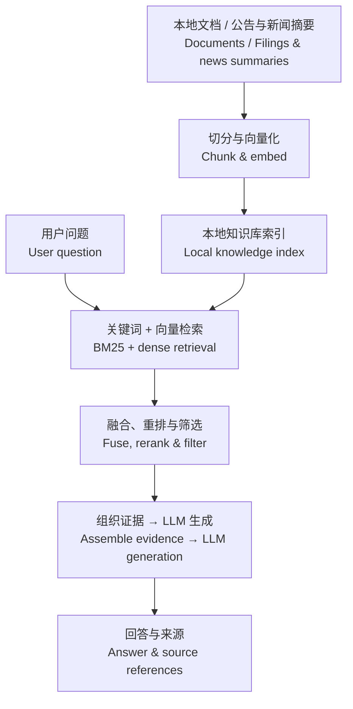

# DeepSearch Agent

面向文档问答与公司研究的检索增强 Agent：从本地资料中检索证据、生成带来源的回答，并可通过工具调用整理 PDF 简报。

A retrieval-augmented agent for document Q&A and company research: find evidence in local sources, generate answers with source references, and create PDF briefs through tool calls.

## 使用场景 · Use cases

| 场景 · Scenario | 你可以做什么 · What you can do | 入口 · Entry point |
| --- | --- | --- |
| 文档问答 · Document Q&A | 上传 Markdown，查询概念、流程或技术细节。<br>Upload Markdown and ask about concepts, procedures, or technical details. | Web UI |
| 公司研究 · Company research | 采集公司公告与新闻摘要，梳理风险、经营情况或比较不同公司。<br>Ingest filings and news summaries to explore risks, business performance, or company comparisons. | Web UI / Agent API |
| 研究简报 · Research briefs | 让 Agent 检索资料、组织章节并生成 PDF。<br>Ask the agent to retrieve evidence, organize sections, and generate a PDF. | ReAct API |

默认知识库是 `data/docs/` 中的技术教材；公司研究需要先采集金融资料。回答范围取决于已入库内容。

The default corpus in `data/docs/` contains technical learning material. Ingest financial sources before company research; answers depend on what is in the knowledge base.

## 工作流程 · Workflow



以上是共享检索流程。三个入口在此基础上提供不同的交互方式：

The retrieval flow above is shared. Each entry point adds a different interaction pattern:

| 入口 · Entry point | 执行流程 · Execution flow |
| --- | --- |
| **Web UI** — `POST /chat/stream` | 直接检索 → 流式回答；支持引用、聊天记录和 Markdown 上传。<br>Direct retrieval → streamed answer, with references, chat history, and Markdown uploads. |
| **Agent API** — `POST /chat` | Planner 重写或拆分问题 → RAG 回答 → 启发式验证，必要时改写重试 → 合并子答案。<br>Planner rewrites or decomposes the question → RAG answers → heuristic verification and retries when needed → merged answer. |
| **ReAct API** — `POST /chat`, `mode=react` | LLM 按任务选择知识库检索、PDF 生成等工具，循环执行后返回结果。<br>The LLM selects knowledge search and PDF tools, iterates, and returns the result. |

网页使用直接检索流程；完整规划与验证通过 Agent API 使用。ReAct 需要支持工具调用的模型，PDF 保存在服务端 `data/exports/`，响应返回文件路径。

The web UI uses direct retrieval; planning and verification are available through the Agent API. ReAct requires a model with tool-calling support. PDFs are saved on the server in `data/exports/`, and the response includes the file path.

## 快速开始 · Quick start

使用 Python 3.10+，在项目根目录执行。以下命令适用于 macOS / Linux。

Use Python 3.10+ and run from the repository root. Commands below are for macOS / Linux.

```bash
python3 -m venv .venv
source .venv/bin/activate
python -m pip install -r requirements.txt
```

创建 `.env`，配置模型服务。可通过 `LLM_BASE_URL` 和 `LLM_MODEL_NAME` 切换兼容服务。

Create `.env` with your model credentials. Set `LLM_BASE_URL` and `LLM_MODEL_NAME` to use another compatible service.

```dotenv
LLM_PROVIDER=openai
LLM_API_KEY=your-api-key
LLM_MODEL_NAME=gpt-4o-mini
# LLM_BASE_URL=https://api.openai.com/v1
CHUNKER_CLASSIFIER=rule
```

启动后端；另开终端，在同一目录激活虚拟环境后启动前端。

Start the backend. In a second terminal, activate the virtual environment in the same directory and start the frontend.

```bash
# Terminal 1: backend
python main.py

# Terminal 2: frontend
python -m http.server 8080 --directory frontend
```

打开 [Web UI](http://localhost:8080)，或在 [API Docs](http://localhost:8000/docs) 中调用完整 Agent。服务启动时自动检查语料并更新索引；首次使用会下载 embedding / reranker 模型。

Open the [Web UI](http://localhost:8080), or use [API Docs](http://localhost:8000/docs) for the full agent. Startup checks the corpus and updates its index; the first use downloads embedding / reranker models.

聊天记录保存在 SQLite。需要 Agent 短期对话记忆时，连接 Redis（默认 `redis://localhost:6379/0`，可用 `REDIS_URL` 修改）。没有可用模型凭据时会进入本地兜底模式，无法提供正常的模型回答或 ReAct 工具调用。

Chat history is stored in SQLite. Connect Redis for short-term agent memory (`redis://localhost:6379/0` by default, configurable via `REDIS_URL`). Without usable model credentials, the local fallback does not provide normal model answers or ReAct tool calls.

## 金融研究配置 · Financial research setup

在 `.env` 中增加以下配置，然后采集资料并启动服务。保持 `DOCS_DIR` 与 `FINANCE_DOCS_DIR` 一致，采集和服务使用同一个 `INDEX_DIR`。

Add these settings to `.env`, then ingest sources and start the service. Keep `DOCS_DIR` and `FINANCE_DOCS_DIR` aligned, and use the same `INDEX_DIR` for ingestion and serving.

```dotenv
FINANCE_DOCS_DIR=data/docs_finance
DOCS_DIR=data/docs_finance
INDEX_DIR=data/index_finance
EDGAR_USER_AGENT=Your Name your-email@example.com
ALPHAVANTAGE_API_KEY=your-alphavantage-api-key
```

```bash
python scripts/ingest_finance.py
python main.py
```

数据来源为 SEC EDGAR 的 `10-K`、`10-Q`、`8-K`，以及 Alpha Vantage 的新闻摘要与情绪元数据。重新运行采集脚本可更新资料；已有文档仅需重建索引时，运行 `python scripts/ingest_docs.py`。

Sources include SEC EDGAR `10-K`, `10-Q`, and `8-K` filings, plus Alpha Vantage news summaries and sentiment metadata. Rerun ingestion to refresh sources; run `python scripts/ingest_docs.py` to rebuild an index from existing documents.

例如，通过 ReAct API 将已采集的资料整理为简报：

For example, use the ReAct API to turn ingested sources into a brief:

```bash
curl http://localhost:8000/chat \
  -H 'Content-Type: application/json' \
  -d '{"query":"Summarize AAPL risk factors from the knowledge base and create a PDF brief with source references.","session_id":"research-aapl","mode":"react"}'
```
